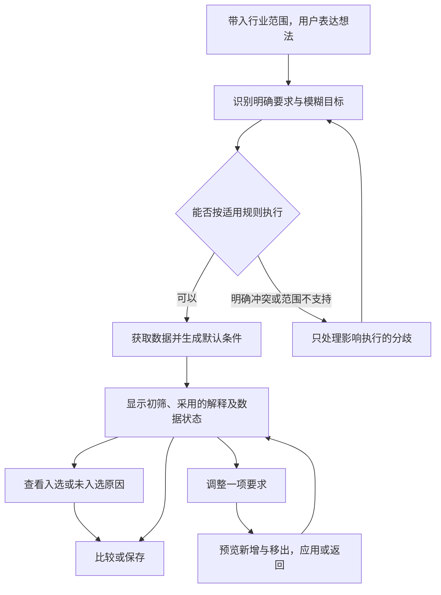

# v5 交互与技术设计：先给初筛，再按结果调整

> 设计阶段记录。实施中的范围裁定和最终行为以 [PRD](../superpowers/specs/2026-10-15-stock-intent-v5-prd.md)、[技术设计](../TECHNICAL_DESIGN.md)和[测试报告](../TEST-REPORT-V5.md)为准；本文的预验证清单不能当成当前未执行或已通过的证明。

日期：2026-10-15。状态：设计提案，未实施。依据：[v5 PRD](../superpowers/specs/2026-10-15-stock-intent-v5-prd.md)；研究及否决理由见[对抗性审查](2026-10-15-v5-research-and-review.md)。

## 1. 主链路及用户的决策



常规路径只有一次表达和一次提交。系统自行完成指标选择、默认数值计算、报告期预置和筛选。用户不必先选“偏稳健还是偏成长”，也不必逐个确认默认参数。

后续真正有意义的决定是：这次解释是否符合自己的想法、想放宽哪一项要求、想继续研究哪几家公司。这些决定在有实际结果后发生。

表达框在首次页面表示“开始一次筛选”，结果页的表达框表示“调整本次筛选”。两者由页面状态区分，不再提供“新建 / 修改”的模式下拉框。结果页仍有低优先级的“重新筛选”入口，明确开启新任务。

## 2. 页面 A：进入与输入

移动端为主，桌面沿用同一阅读顺序，不在左侧常驻一整列参数。

```text
‹ 白色家电                       按想法选股

范围：白电整机观察组       查看范围
财报：2026 年中报

想找什么样的公司？
┌──────────────────────────────┐
│ 经营改善、估值别太高、走势相对稳定 │
└──────────────────────────────┘
系统会先选好筛选标准，你可以在结果里调整。

              [ 按这个想法筛选 ]
```

“查看范围”解释：使用同花顺白色家电板块，剔除零部件板块成分；完整名单与分类时间可查。入口处已经表明仅支持该观察组，不能在用户提交后才偷偷缩小一个全行业请求。

示例文本可直接提交，不要求用户改写。没有上下文的独立 Demo 明确显示这是演示场景。未来同花顺正式接入才可使用真实页面上下文；本轮不假装已接入账户。

## 3. 页面 B：结果优先

下面所有公司、数值与数量均为**构造的交互示例**，不是市场数据。完整构造数据及算式在文末，用于核对设计稿内部一致性。

```text
‹ 白色家电                       本次筛选
经营改善、估值别太高、走势相对稳定

本次按这些要求筛：                         查看条件
• 营收、归母利润都比去年同期增加
  同时看业务收入和股东利润，避免只增收、不增利。
• 近两年及本期盈利，PE 不高于盈利组中位数：18 倍
  对照每 1 元盈利对应的股价，先比较同行的中间水平。
• 过去 60 日起伏、最大回落不高于本组中位数
  波动率上限 22%，回撤上限 8%
  两项一起看，避免把持续缓跌误当成走势稳定。
这是筛选起点，未判断合理价格或未来风险。

符合 2 家    其余 6 家                 调整要求
按股票代码排列

┌ 示例乙                         符合本次条件 ┐
│ 经营  营收 +8%，归母利润 +12%，均比同期增加 │
│ 估值  PE 12 倍，本组筛选上限 18 倍        │
│ 走势  起伏 14%，最大回落 4%，均在上限内    │
│ 尚未核查：一次性收益与经营现金流           │
│ 查看依据                       加入对比  │
└────────────────────────────────┘
┌ 示例丁                         符合本次条件 ┐
│ ……同样展示三行依据……                    │
└────────────────────────────────┘

财报：2026 年中报 ｜ 行情：截至本轮交易日
来源：扶摇 ｜ 同行基准：本轮数据             数据详情

               [ 保存这次筛选 ]
```

主页面不显示“AI 精选”“综合分 93”“胜率”或“最值得买”。每项目标下的用途说明常显，不能只放在问号里；详细口径再按需查看。“起伏 14%”旁保留可点击的“年化波动率”说明，不能让用户误以为股价最多跌 14%。卡片首屏展示回撤的绝对数值，不能只用“低于同行”掩盖整体较大的跌幅。

实际产品中的数量、阈值、来源时间和公司数值必须全部来自当前运行。加载中只展示真实进度或等待状态；不使用固定的 2 家、18 倍等设计示例。

结果较多时先呈现最多三张，显示“查看全部 N 家”。这只减少首次阅读量，不限制真实结果、不暗示前三名更好。其余股票可按名称查询，避免用户为了找到一只落选股票翻阅全表。

## 4. 页面 C：解释与修改在同一个面板

从“查看条件”、卡片的指标行或“查看依据”进入同一个底部面板；桌面使用侧栏。默认展开用户点到的项目。页面主信息与详情只有两层，原始数据在详情内展开，不再跳入第三层页面。

### 估值条件面板

```text
估值怎么筛                         关闭

本次：PE 不超过 18 倍
PE 是股价相当于每 1 元过去一年每股盈利的多少倍。

为什么是 18？
本组近两年及本期盈利的 8 家公司，PE 中位数为 18 倍。
先按中间水平筛，便于缩小范围；它不是合理价格。

这个条件会影响什么？
调高上限，会允许盈利倍数更高的公司进入，
公司数量可能增加；并不代表公司变得更好。

当前：不高于中位数            18 倍
[ 估值放宽一点 ]              预览：2 家 → 4 家

自行设置参数                  展开
同行名单与排除原因            展开
原始数据和计算过程            展开
```

设置多少的意义必须和本次结果连接：放宽时显示新增公司及原来未通过的项；收紧时显示移出公司及原因。没有变化就显示“本次名单不变”，不渲染不存在的收益或风险提升。

参数编辑在面板内展开，显示指标、单位、比较符和数值；有明确专业需求的用户仍能直接修改。每个控件就地解释，不能依赖用户先阅读总帮助页。

### 经营条件面板

默认说明：“同时看收入和归属于股东的利润是否比去年同期增加。两项都大于 0，表示规模和账面利润都在增长。”

阈值解释：“从大于 0 改为大于 10%，会要求增长幅度更高，可能排除增长较慢的公司。它不能区分增长是否可持续。”只有用户提出更高增长要求或打开自行设置时，才展示这种数值调整。

不能使用“经营全面向好”“盈利质量提升”等本轮数据无法证明的判断。用户说“改善就是扭亏”时，必须保留这个含义；当前正盈利同比方案不适用，不能用同比正增长替代。

### 走势条件面板

先区分两件事：“波动率看日常涨跌起伏；最大回撤看从这段时间的高点最多回落多少。”再说明本次同时采用它们的原因：“只看起伏，可能漏掉一直缓慢下跌的情况。”

展示两个实际上限、价格窗口和对应同组中位数。快捷修改“少些起伏和回落”同时收紧两项，并在预览中明确列出这两个变化。不能只写“风险降低”或暗示未来最多亏损某个百分比。

## 5. 页面 D：变化先预览，再应用

以下继续使用同一构造数据。

```text
估值放宽一点

PE 上限：18 倍 → 25 倍
依据：从本组 P50 调整至 P75
经营、走势、报告期和数据保持本次版本。

符合：2 家 → 4 家
新增：示例戊、示例己
原因：原来只有 PE 超过 18 倍；现在均不超过 25 倍。
移出：0 家

这次允许更高的盈利倍数，不代表价格更划算。
             [ 应用修改 ]   返回
```

应用后在结果顶端显示“已放宽估值，新增 2 家”，提供“撤销”。撤销恢复上一份策略与结果，不重新取数。用户明确说“把 PE 改成 20，其余不变”时，预览只包含 PE 的变更。

不要使用“多给我几只”作为会自动改变多条条件的黑箱按钮。如果用户这样表达，系统展示可行的单项调整及实际数量，用户选择其中一项；不悄悄把所有标准调松。

## 6. 其余股票、异常与恢复

| 状态 | 用户看到的内容 | 可执行动作 |
|---|---|---|
| 已知不符合 | “PE 超过本次上限；经营和走势符合”及实际值；若还有缺失项也保留 | 查看依据、预览修改该条件 |
| 数据待核验 | “缺少完整价格窗口，暂时不能判断走势”；显示已验证项 | 重试取数、保存为未完成筛选；不写符合全部要求 |
| 默认方案不适用 | “同比基期为负，本轮普通增长比较不适用”等具体理由 | 查看原始值；明确提出另一种研究方式，不能自动替换公式 |
| 全部条件无人符合 | “本次没有全部符合的公司”；显示单项调整后的真实结果 | 预览并决定是否应用；不自动放宽 |
| 同业基准不够可靠 | “有效同行不足，暂不能按同行标准判断估值”；显示样本数和缺口 | 重试；查看已有事实。没有随意 PE 输入框作为默认补救 |
| 模型失败 | “这次没能解析你的想法，原输入已保留” | 重试；“使用页面上的示例方案”，需用户点击，明确标注预置方案 |
| 明确条件互斥 | “PE 同时要求高于 30、低于 15，无法同时满足” | 保留低于 15、保留高于 30、修改原话；不替用户选择 |
| 部分要求不支持 | 逐项指出未处理要求；已有事实可看，但不展示完整命中结论 | 改写，或明确“本次不使用该项”；保留略过记录 |
| 保存成功 | 自动命名，例如“白电整机·经营增长与同行比较·10月15日” | 查看已保存、可选重命名 |
| 打开旧记录 | “历史结果”，显示原始数据时点和原有默认基准 | 在原快照下继续比较；“按当前数据重跑”另建运行 |

有技术故障时给出能理解的原因；HTTP 状态、请求标识放在详情内供排查，不直接把缓存异常英文堆到用户脸上。金融事实缺口不能通过静默省略来改善界面观感。

## 7. 用户输入与认知负担的控制

| 项目 | v5 的约束 |
|---|---|
| 首次必填 | 自然语言想法；也可直接采用已显示的示例 |
| 首次必填数值 | 0 |
| 首次必选指标 | 0 |
| 首次常规澄清 | 0；有实质冲突或未支持的明确要求才出现 |
| 强制确认勾选 | 0 |
| 默认方案选择 | 不先摆三套方案要求选择，直接展示本场景默认解释 |
| 保存必填名称 | 0，自动生成 |
| 专业参数 | 始终可访问，但按需展开 |
| 说明方式 | 意义 → 本次标准及依据 → 修改影响 → 原始证据 |

以上是设计验收约束，不是已经测得的用户效果。目标不是让人闭眼点击；结果页必须保留足以判断的比较对象、实际值、日期和局限。

## 8. 技术方案调整

### 8.1 执行链路

沿用 React、TypeScript、Vinext、服务端模型调用和纯函数筛选引擎。新增的必要能力是版本化默认规则和同业基准服务，不另建多 Agent、模型训练或复杂 RAG 系统。

```text
页面上下文 + 用户表达
  → AI 输出目标、明确约束、未处理要求、局部修改意图
  → 规则校验与默认策略解析
  → 取数、适用性检查、观察组与基准快照
  → 默认分位解析成实际数值条件
  → 确定性执行
  → 结果 + 采用的解释 + 原始证据 + 可重算的变更预览
```

“估值合理”不再无条件产生一个阻塞的 `valuation` 待确认项。在适用策略和可靠基准存在时，解析为“本组正 PE 的默认中位数”；缺少基准是数据或能力状态，不是要求用户填数字的偏好问卷。

### 8.2 状态与数据契约

| 对象 | 必须保存的内容 |
|---|---|
| `Context` | 入口、明确命名的范围、板块代码和范围规则版本；Demo 上下文标识 |
| `IntentPlan` | 原话、明确要求、模糊目标、未支持项、解析模型和请求标识 |
| `ResolvedPolicy` | 默认规则版本、适用性、为什么采用、哪些内容由系统假设 |
| `PeerSnapshot` | 父板块与零部件名单、集合差、业务审核版本、适用/不适用/待定成员及理由 |
| `BenchmarkSnapshot` | 每项有效样本、原值、缺失原因、覆盖率、分位结果、单位、来源时点 |
| `AppliedCondition` | 字段、方向、实际数值、源自用户还是默认；相对阈值关联基准 ID |
| `ResearchRun` | 意图、已执行条件、数据和基准版本、逐股状态、生成时间；不伪造用户确认 |
| `ChangePreview` | 基础运行版本、仅被修改的条件、前后数量、新增/移出/未知状态变化 |

现有 `/api/interpret` 可继续负责意图，不接收证券原始数据。新增 `/api/screen` 编排默认解析与取数，返回完整运行或明确的澄清/数据状态。仅参数调整在已验证快照上重算；刷新数据显式生成新快照。接口名称是设计建议，本轮没有创建这些路由。

原条件表单可保留为详情中的高级编辑，不再驱动首次页面。现有引擎的三态、阈值原始精度、有限修改、旧响应防覆盖、保存恢复和缓存故障保护继续沿用；股票池适配必须解除“固定 50 只、只允许 SH”的旧约束，按明确范围校验数量和全代码。

### 8.3 分位与数据一致性

有效样本升序排列为 `x[0..n-1]`；分位参数 `q∈[0,1]`，位置 `h=(n−1)q`，在相邻两项间线性插值。默认 q=0.5；估值放宽使用 0.75；历史起伏与回撤收紧使用 0.25。样本数、覆盖门槛与适用性规则以 PRD 为准。

相同值会使实际通过比例超过一半，因此文案写“不高于中位数”，不写“严格筛出最低的 50%”。PE 使用盈利适用组 B_PE，走势使用有效价格组 B_PRICE，不能因为公司亏损而删去其有效历史价格来改变风险基准。先计算基准再筛选，禁止用入选公司重新计算同业中位数。只改条件不能改变基准样本。

财报严格同报告期与币种；同比使用有效正基期。价格使用相同交易日历和 61 个有效价格；停牌或缺值不补齐。元数据时间与获取时间分别保存；供应商没有给字段有效时间时明确记录未知，不把请求返回时间伪装成其生效时间。

数据源分类不能拼成一个无定义的同行组。iFinD 的申万数量与扶摇的同花顺板块差集即使相同，也不等于成员一致。最新分类可描述本轮获取到的当前清单，不能据此做历史成分回测。

### 8.4 防止默认方案变成误导

- 模型不能决定比较组成员、默认百分位、真实阈值或入选数量。
- 明确要求优先于默认；没有提及的维度不自动加入。
- 同业基准质量不合格则无法判断，不使用兜底的 PE=25。
- 用户应用调整前可见其范围和结果；有并发新版本时旧预览不可应用。
- 保存来源标记和全部采用的解释，不能把系统默认记成用户明确输入。
- PE、波动率和回撤均不生成收益或未来风险承诺；无买卖动作。

## 9. 实施前验证与范围控制

本轮已只读验证扶摇行业目录和两份成分名单：44 个白色家电板块成分、33 个零部件成分，集合差 11 个。数据只证明能得到这一供应商定义的观察范围。尚未证明所有成员的业务可比性、所有财报与行情均可用，或上述默认条件会选出任何特定数量。

后续开发按以下依赖顺序估时，本文不授权或启动实施：

1. 核定观察组与默认规则，验证全组财报、估值、历史价格和基准覆盖。拿不到可信同业数据就先解决该问题。
2. 增加可独立验证的适用性、基准统计、默认来源记录，复用已有筛选引擎。
3. 重排首次输入、结果卡、解释面板和修改预览；移除强制填阈值、勾确认、命名的主链路要求。
4. 验证意图保留、同行缺失、不同股类、异常回退、固定快照重算和保存恢复；再做真人理解测试。

不能以跳过同业验证来压缩工期。若数据验证后仍超出两小时预算，保持一个观察组、一套默认解释、一种比较、一种保存，不增加行业模板、监控或回测。

## 10. 设计稿构造数据与算式

这些公司不存在，全部假设满足默认盈利适用性；财报两项增速均为营收 +8%、归母利润 +12%。本表只用于检查交互样例，不能导入正式 Demo 充当真实市场结果。

| 构造公司 | PE（倍） | 60 日年化波动率 | 60 日最大回撤 |
|---|---:|---:|---:|
| 示例甲 | 10 | 32% | 15% |
| 示例乙 | 12 | 14% | 4% |
| 示例丙 | 14 | 28% | 12% |
| 示例丁 | 16 | 16% | 5% |
| 示例戊 | 20 | 18% | 6% |
| 示例己 | 24 | 20% | 7% |
| 示例庚 | 28 | 24% | 9% |
| 示例辛 | 32 | 26% | 10% |

PE 的 P50=(16+20)/2=18；P75=24+0.25×(28−24)=25。波动率 P50=(20+24)/2=22%；回撤 P50=(7+9)/2=8%。

默认五项条件下符合者为乙、丁。仅将 PE 上限由 18 改为 25，其余条件、范围和数据不变，新增戊、己，总数由 2 变 4，移出为 0。示例甲、丙虽 PE 较低，仍因历史起伏和回撤不符合而未入选，说明“估值较低”不会替代其他条件。
